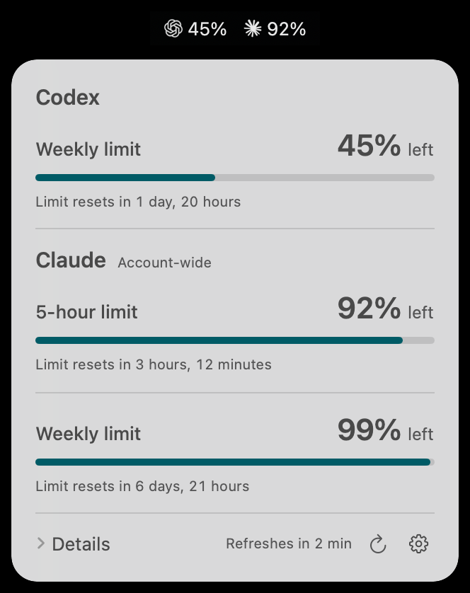

# QuotaBar

## First launch on Mac

> [!IMPORTANT]
> **If macOS says it can’t verify QuotaBar or its developer**, dismiss the alert. Go to **System Settings → Privacy & Security**, scroll to **Security**, find **QuotaBar**, and click **Open Anyway**. Confirm when prompted. This approves only QuotaBar. Use these steps only for a copy you trust from the official release.

**Install on Apple Silicon Macs running macOS 14 or later.** Download **QuotaBar-macOS.zip**, unzip it, move **QuotaBar.app** to Applications, and try opening it once. That first attempt makes the approval option appear if Gatekeeper blocks the app. [Download QuotaBar 1.7.5](https://github.com/quittnet/QuotaBar/releases/tag/v1.7.5)

Version 1.7.5 is ad-hoc signed and hasn’t been notarized by Apple. If the alert says the app **will damage your computer**, stop and follow Apple’s guidance. [Apple’s guide to opening Mac apps safely](https://support.apple.com/en-us/102445)

QuotaBar shows Codex and Claude usage in the macOS menu bar. **Amount Left** is the default. Secondary-click the menu bar item (two-finger click or Control-click), or click the percentage inside the dropdown, to switch between **Amount Left** and **Amount Used**. You can also choose **Settings → Show Percentage As**. The choice applies to both providers and survives relaunch. Each status reading uses the most constrained active usage window.

Live usage requires a signed-in command-line interface (CLI) for each provider you enable. QuotaBar detects supported bundled CLIs automatically. The first time it detects a missing CLI, it opens the dropdown with that provider’s installation guide. Follow the guide, sign in, then click **Refresh**. [Install Codex CLI](https://developers.openai.com/codex/cli/) · [Install Claude Code](https://code.claude.com/docs/en/quickstart)

Choose **Settings → Help** for a quick guide to clicks, shortcuts, and usage readings. Click the menu bar item to open or close the dropdown. With both providers enabled, the dropdown shows both providers’ limits above Details, even with a single menu-bar badge. In Details, select Codex or Claude to switch between their token totals and reset controls. An unavailable reading opens its details with either click. Each current usage bar shows a countdown to its reported reset. Refresh and Settings stay in the bottom-right corner. Expand **Details** once to see available resets and local token history together. QuotaBar remembers whether Details is expanded across providers and launches.

Use **Settings → Providers** to choose ChatGPT (Codex) only, Claude only, or both. A single-provider choice hides the other provider and stops its usage checks. You can change this at any time.

Open **Settings** to change the menu-bar layout. **Both Providers** shows both logos and percentages side by side. **Logo and Percentage** and **Percentage Only** show the selected provider. On first launch, QuotaBar looks for local history directories. If it finds both providers, it shows both. If it finds neither, it starts with Codex.

Enabled providers refresh at launch, every three minutes, after wake, and when the Mac reconnects or switches networks. Three dots pulse while QuotaBar waits for a current reading, or stay still when Reduce Motion is enabled. While the Mac is offline, the Codex badge shows a dash. Click the refresh button or press ⌘R in the dropdown for an immediate update and a new three-minute countdown. Hover over a percentage for its source and report time. After a failed read, a scheduled reset, a reported Codex restriction, or 3 minutes 15 seconds without a new report, the menu shows a dash. Details identifies historical readings by time. Provider activity between refreshes can change the actual balance.

A failed quota read withdraws the menu percentage and shows the reason in the compact dropdown. Transient Codex failures retry after 5, 15, 30, then 60 seconds until a read succeeds. The regular three-minute check and manual refresh can run sooner. When offline, QuotaBar waits for a network connection. A rejected request prompts sign-in only if the CLI confirms it. Read retries never spend reset credits.

## Codex

QuotaBar asks the installed, signed-in Codex CLI for account limits. When Codex reports available usage resets, the dropdown shows their count and next known expiry. Choose **Use Reset** and then **Use 1 Reset** to spend one on eligible Codex limits. QuotaBar selects the available credit with the earliest reported expiry when details are available. Codex chooses the credit when it supplies only a count. After a connection interruption, **Retry Same Reset…** reuses the saved request so the same action can be applied only once.

## Claude

Enable Claude in **Settings → Providers** and sign in to a supported Claude Code CLI with your subscription. QuotaBar asks the local CLI for account usage on launch, every three minutes, on wake or reconnect, and when you press Refresh or ⌘R. Claude Code handles the account request in the background. It does not need an open Terminal window or a chat message. The reported five-hour and weekly limits are account-wide. Local token totals cover Claude Code history on this Mac. A reported percentage can arrive before Claude assigns a reset time. The percentage appears immediately and the countdown appears when Claude supplies a time. Manual Claude resets are unavailable in QuotaBar.

The automatic check uses Claude Code’s version-dependent usage control request. If the installed CLI reports that the request is unsupported, QuotaBar can still read the older status-line feed. **Connect Claude Code** in that mode preserves existing status-line output. Upgrading Claude Code enables automatic checks on supported versions. A failed account read hides the current percentage until the next successful check. [Claude Code usage command](https://code.claude.com/docs/en/commands) · [Claude Code status-line fields](https://code.claude.com/docs/en/statusline#rate-limits)

## Token history

The dropdown shows tokens recorded on this Mac for the selected provider, across all retained history, the last 30 days, the last 7 days, yesterday, and today. The 7-day and 30-day ranges include today. Yesterday covers the previous local calendar day. Token totals refresh every three minutes, when the dropdown opens, and while it stays open. Missing records are shown as unavailable, and incomplete scans are marked as partial. A saved Claude lifetime total can still appear when transcripts are missing.

Codex totals include local active and archived sessions, including compressed logs when zstd is installed. Claude totals include Claude Code project and subagent transcripts, counting input, cache creation, cache reads, and output once per response. Removing a local transcript removes its contribution on the next scan. When available, **All time · Claude /stats** shows the lifetime total saved by Claude Code itself. It can include older activity and repeated response entries. **All retained sessions** and the four date ranges count each response once.

## Privacy and permissions

QuotaBar runs under the signed-in macOS user. It reads enabled providers’ local session logs to count tokens. The Codex cache contains file paths, session and response identifiers, timestamps, and token counts. The Claude quota cache contains reported windows, timestamps, and hashed session identifiers. QuotaBar does not save prompt or response text in these caches. Reset recovery stores request identifiers, credit references, and account fingerprints locally.

QuotaBar has no analytics service or direct usage-data upload. It requests subscription limits through the installed provider CLIs, which handle their own authentication and network traffic. Connecting the legacy Claude Code status-line feed updates the user’s status-line settings after an explicit click and keeps a private backup of the previous settings. A Codex reset requires a separate confirmation.

## App updates

Open the dropdown and choose **Settings → Check for Updates…**. If a newer release is available, choose **Install Update**, then **Install and Relaunch** when prompted. QuotaBar verifies the signed update feed and download before installing. You can enable **Automatically Check for Updates** to receive notifications. Usage refresh and ⌘R only refresh your usage.

Users on v1.7.5 or earlier must download the first updater-enabled release manually. Move it to Applications and follow the first-launch instructions above. Subsequent updates use the installed app. [QuotaBar releases](https://github.com/quittnet/QuotaBar/releases)

### Preparing an update

The free release path uses Sparkle’s Ed25519 signature and ad-hoc macOS signing. The project contains the public key in `Resources/UpdatePublicKey.txt`. Its paired private key belongs in the release maintainer’s login Keychain under the Sparkle account `quotabar-updates`. Keep a secure backup of that key so future releases can update existing installations. [Sparkle signing guide](https://sparkle-project.org/documentation/#eddsa-ed25519-signatures)

1. Increase the version and build number in `Resources/Info.plist`. Sparkle compares the integer build number.
2. On the Apple Silicon release Mac, run `./check.sh --lint` and `./release-update.sh`. The script writes the signed app archive, signed feed and checksums under `release-updates/v<VERSION>/`.
3. To publish, attach **QuotaBar-macOS.zip**, **appcast.xml**, and **SHA256SUMS.txt** from that same directory to the matching GitHub release tag, then mark it latest. The archive must match the exact bytes signed in the feed. The build and release scripts only create local files.

For a notarized release, set `QUOTABAR_SIGN_IDENTITY` to your Developer ID Application identity and `QUOTABAR_NOTARY_PROFILE` to your notarytool Keychain profile before running the release script. [Apple Developer ID setup](https://developer.apple.com/developer-id/)

## Build and checks

On macOS 14 or later with Xcode Command Line Tools, run `./build.sh` and open `build/QuotaBar.app`. To start the app at login on another Mac, add it under System Settings → General → Login Items & Extensions.

Run `./check.sh` for compiler checks and quota, reset, presentation, and token fixtures. With Swift 6 command-line tools, `./check.sh --lint` also checks Swift style, shell syntax, and the bundle property list. Run `./check.sh --live` in a logged-in macOS session to exercise the menu-bar button, switch providers, and fetch live Codex account limits. The optional capture paths are PNGs for the Codex dropdown, Claude dropdown, light menu bar, and dark menu bar, followed by the combined compact dropdown and its Codex and Claude Details views, in that order.

After updating Claude Code, run `./check.sh --claude-live` on a Mac signed in to a supported Claude subscription. It reads the installed CLI once and checks both menu-bar percentage modes. The output omits account details and percentages. The ordinary test suite runs offline using fixtures. The release packaging script runs those tests against the staged source before building the downloadable app.

Run `./check.sh --logic-stress` to check percentage accuracy at report and reset boundaries, account restrictions across relaunches, and reset decisions across simulated event sequences. It runs without opening windows or contacting either provider.

Run `./check.sh --stress` for the window-free stress suite. It uses simulated providers and temporary histories to check percentage accuracy, token accounting, and simultaneous reset confirmations across separate processes.

Run `./check.sh --stress-gui` separately in a dedicated macOS graphical session or a macOS VM with Accessibility access for the runner. This suite opens windows and drives the menu bar. A second Mission Control Space shares the same menu bar and focus. Allow several minutes for launch and onboarding, provider and display settings, dropdown and keyboard interaction bursts, network changes, the three-minute refresh deadline, and signed updates served on localhost. The first updater test may download the pinned Sparkle tools. Actual subscriptions, real reset credits, and macOS login-item configuration are outside the stress suites.

Run `./check.sh --update-stress` for window-free updater tests. It exercises QuotaBar’s update reminders and checks Sparkle against disposable signed feeds on localhost. The first run may download the pinned Sparkle toolset.

Run `./Tests/UpdaterChecks.sh` in a logged-in macOS session with Accessibility access for the test runner. It uses disposable apps, a local feed, and a temporary signing key to test installation, relaunch, and rejection of an altered update.

Run `./check.sh --timing` in a logged-in macOS session for a three-minute test with isolated histories and simulated readings. It checks automatic updates with the dropdown closed, a network failure, and recovery on a wake notification.

Run `./check.sh --network` to exercise startup without connectivity, reconnects, network switches, and late responses from a previous connection using simulated readings.

For screenshots with simulated quota readings and isolated token history, run `QUOTABAR_TEST_FIXTURES=1 ./check.sh --live` with the desired capture paths. Ordinary live checks and screenshots can contain the current user’s usage.

Run `./package.sh` with a release directory to build the app and source archives from the release manifest. The default local build includes the updater. Use the signed archive and feed from the release procedure above for distribution through the updater. Distribution outside the Mac App Store with a verified publisher requires Developer ID signing and Apple notarization. [Apple distribution guidance](https://developer.apple.com/documentation/security/notarizing-macos-software-before-distribution)
